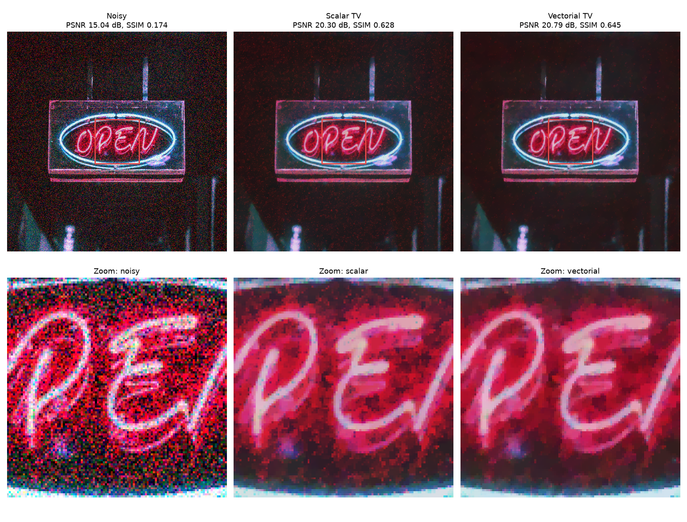
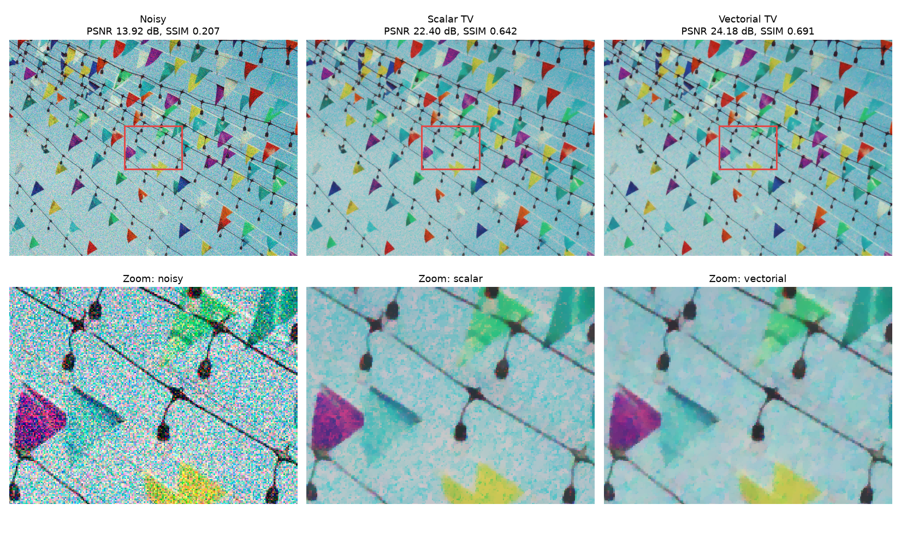
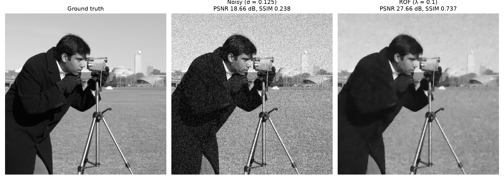

# Vectorial ROF Denoising for Low-Light Color Images

**English** | [繁體中文](README.zh-TW.md)

Low-light photos carry strong chroma noise: random red, green and blue speckles on top of the grain. Denoising each RGB channel separately with total variation (TV) removes the grain but leaves colored blotches and color fringes at edges, because the three channels place their edges in slightly different spots. This project compares channel-by-channel **scalar TV** with **vectorial TV (VTV)**, which couples the channels so that they share edges. Both are solved with a primal–dual algorithm that runs on the CPU (NumPy) or the GPU (CuPy).

Undergraduate research project, Department of Applied Mathematics, Chung Yuan Christian University (September 2025 – January 2026), advised by Prof. 謝天長. [Report (Chinese, PDF)](docs/final_report.pdf) · [Poster (Chinese, PDF)](docs/poster.pdf)



## Method

**ROF model.** For a grayscale image *f*, Rudin, Osher and Fatemi (1992) find the image *u* that minimizes

$$E(u) = \int_\Omega |\nabla u|\,dx + \frac{\lambda}{2}\int_\Omega (u - f)^2\,dx .$$

The TV term allows sharp jumps, so edges survive while flat regions are smoothed.

**Scalar TV** applies the model to each channel independently:

$$J_\text{scalar}(u) = \int_\Omega |\nabla u_R|\,dx + \int_\Omega |\nabla u_G|\,dx + \int_\Omega |\nabla u_B|\,dx .$$

**Vectorial TV** takes one norm over all channels' gradients, so a jump in one channel is cheaper when the other channels jump at the same place:

$$J_\text{vectorial}(u) = \int_\Omega \sqrt{|\nabla u_R|^2 + |\nabla u_G|^2 + |\nabla u_B|^2}\,dx .$$

This pushes R, G and B edges to line up (no color fringes), and noise that appears in only one channel has no support from the others, so it is removed.

**Solver.** Both models are written as a saddle-point problem and solved with a primal–dual iteration (Chambolle–Pock style, step sizes τ = σ = 1/8):

1. Dual step: *p* ← proj(*p* + σ∇*u*), projecting onto |*p*| ≤ λ. Scalar TV projects each channel separately; VTV projects the gradients of all channels together. This is the only line that differs between the two models.
2. Primal step: *u* ← (*u* + τ div *p* + τ*f*) / (1 + τ).

The implementation is in [`rof.py`](rof.py) and is written once for both array libraries: pass a NumPy array to run on the CPU, a CuPy array to run on the GPU.

## Experiments and results

Noise is synthetic, so the clean image is known and PSNR / SSIM can be measured. For the color images, low-light chroma noise is simulated with Gaussian noise σ = 0.125 whose red channel is amplified 3×. The λ of each model was tuned separately (scalar 0.15, vectorial 0.22). Each model runs 1,000 iterations.

| Experiment | Noisy | Scalar TV | Vectorial TV |
|---|---|---|---|
| Cameraman, grayscale, σ = 0.125, λ = 0.1 | 18.66 dB / 0.238 | 27.66 dB / 0.737 | — |
| Flags, 1038×779 | 13.92 dB / 0.207 | 22.40 dB / 0.642 | **24.18 dB / 0.691** |
| Neon sign at night, 550×550 | 15.04 dB / 0.174 | 20.30 dB / 0.628 | **20.79 dB / 0.645** |

<sub>PSNR / SSIM against the clean image.</sub>

VTV is better on both color images. The difference is clearest in the zoomed crops: scalar TV keeps red and cyan speckles that it mistakes for texture, while VTV gives flat, consistent color.



**Grayscale ROF** (σ = 0.125, 200 iterations): λ = 0.1 gave the best PSNR among the values tried.

| λ | 0.08 | **0.10** | 0.125 | 0.15 |
|---|---|---|---|---|
| PSNR / SSIM | 27.44 / 0.693 | **27.66 / 0.737** | 27.36 / 0.732 | 26.97 / 0.717 |



**Speed.** 1,000 iterations on the 550×550 image take about 0.5 s per model on an RTX 3090 and 35–50 s with NumPy on the CPU.

### Limitations and next steps

- The noise is synthetic Gaussian noise, not real sensor noise from low-light captures.
- Like all TV models, both produce staircasing in smooth gradients such as the sky. Vectorial TGV (total generalized variation) would address that.
- Denoising in a luminance–chrominance space (YCbCr or Lab) could treat brightness and color noise with different strengths.

## Run it

```bash
pip install -r requirements.txt
# Optional, for an NVIDIA GPU: pip install "cupy-cuda12x[ctk]"

python demo_gray.py                                                  # → results/gray/
python demo_color.py --image images/flags.jpg     --out results/flags
python demo_color.py --image images/open_sign.jpg --out results/open_sign
```

`demo_color.py` uses the GPU when CuPy works and falls back to NumPy otherwise (`--cpu` forces the CPU). Run `python demo_color.py -h` for all parameters (noise level, red bias, λ, iterations, zoom region).

## Project structure

```
├── rof.py           gradient, divergence and the primal–dual ROF solver (scalar / vectorial)
├── demo_gray.py     experiment 1: grayscale ROF, PSNR / SSIM
├── demo_color.py    experiments 2–3: scalar TV vs vectorial TV on color images
├── images/          input photos
├── results/         figures produced by the demos
└── docs/            final report and poster (Chinese)
```

## Image credits

The color test images are resized from photos on [Pexels](https://www.pexels.com/), used under the [Pexels License](https://www.pexels.com/license/): [`flags.jpg`](https://www.pexels.com/photo/35442857/) by orkhanshots and [`open_sign.jpg`](https://www.pexels.com/photo/2995188/) by pratikgupta. The cameraman image is the standard test image bundled with scikit-image.

## References

1. L. I. Rudin, S. Osher, E. Fatemi. Nonlinear total variation based noise removal algorithms. *Physica D* 60 (1992) 259–268.
2. A. Chambolle, T. Pock. A first-order primal-dual algorithm for convex problems with applications to imaging. *J. Math. Imaging Vis.* 40 (2011) 120–145.
