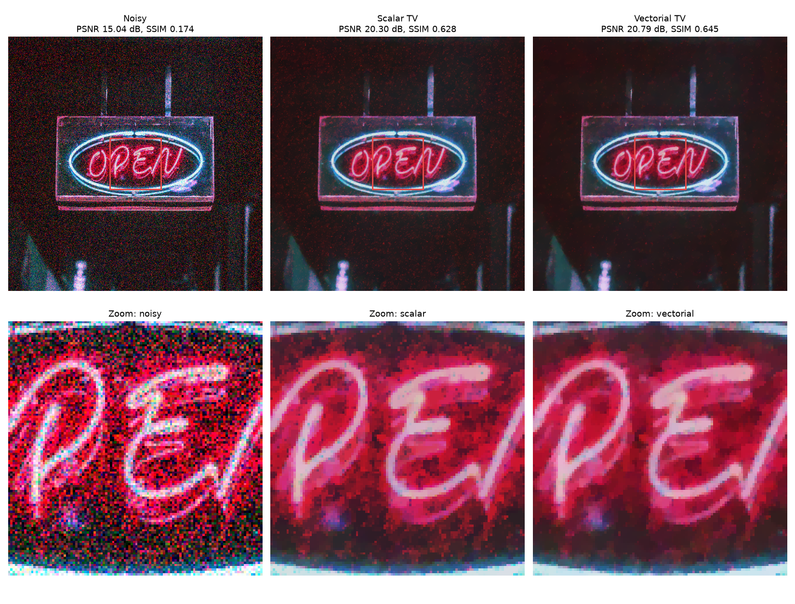
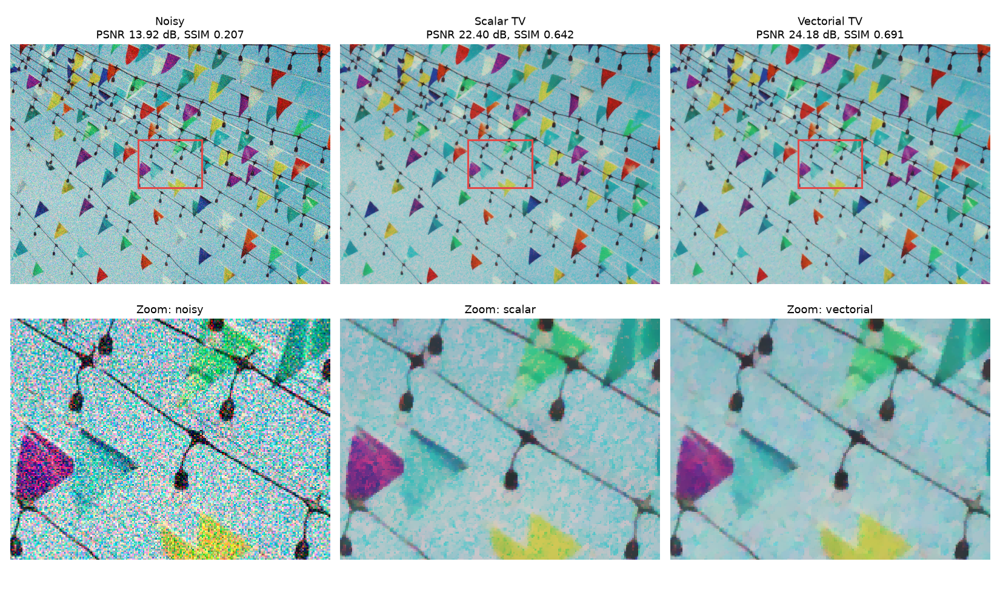
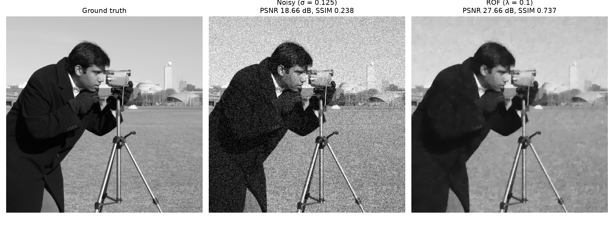

# 基於向量 ROF 模型的低光影像降噪

[English](README.md) | **繁體中文**

低光拍攝的照片除了顆粒感，還有嚴重的色度雜訊（紅、綠、藍交錯的雜色斑點）。若把 RGB 三個通道分開、各自用全變差（TV）去噪，雖然能去除顆粒，但三個通道算出的邊緣位置對不齊，結果會留下斑駁的色塊與邊緣色散。本專案比較逐通道的**純量 TV** 與把通道耦合起來、讓三色共享邊緣的**向量 TV（VTV）**，兩者都以 primal-dual 演算法求解，可在 CPU（NumPy）或 GPU（CuPy）上執行。

中原大學應用數學系學生實作研究專案（2025/09 – 2026/01），指導老師：謝天長。[期末報告 (PDF)](docs/final_report.pdf) · [海報 (PDF)](docs/poster.pdf)



## 方法

**ROF 模型**：對灰階影像 *f*，Rudin、Osher 與 Fatemi（1992）尋找使下列能量泛函最小的 *u*：

$$E(u) = \int_\Omega |\nabla u|\,dx + \frac{\lambda}{2}\int_\Omega (u - f)^2\,dx$$

TV 項允許函數在邊緣處劇烈跳動，因此能在抹平雜訊的同時保留邊緣。

**純量 TV** 把模型分別套用在每個通道：

$$J_\text{scalar}(u) = \int_\Omega |\nabla u_R|\,dx + \int_\Omega |\nabla u_G|\,dx + \int_\Omega |\nabla u_B|\,dx$$

**向量 TV** 對所有通道的梯度取同一個範數，當其他通道在同一位置也有跳變時，單一通道的跳變代價較小：

$$J_\text{vectorial}(u) = \int_\Omega \sqrt{|\nabla u_R|^2 + |\nabla u_G|^2 + |\nabla u_B|^2}\,dx$$

這會迫使 R、G、B 的邊緣對齊（消除偽色）；只出現在單一通道的雜訊得不到其他通道的支持，因此會被抹除。

**數值求解**：兩個模型都轉成鞍點問題，以 primal-dual 迭代（Chambolle–Pock 形式，步長 τ = σ = 1/8）求解：

1. Dual 更新：*p* ← proj(*p* + σ∇*u*)，投影到 |*p*| ≤ λ。純量 TV 對每個通道各自投影，VTV 把所有通道的梯度一起投影。兩個模型只差這一行。
2. Primal 更新：*u* ← (*u* + τ div *p* + τ*f*) / (1 + τ)。

實作在 [`rof.py`](rof.py)，同一份程式碼同時支援兩種陣列：傳入 NumPy 陣列在 CPU 計算，傳入 CuPy 陣列在 GPU 計算。

## 實驗與結果

雜訊是人工加入的，因此有乾淨影像可以計算 PSNR / SSIM。彩色影像以 σ = 0.125 的高斯雜訊、紅色通道放大 3 倍來模擬低光的色度雜訊；兩個模型的 λ 分別調整（純量 0.15、向量 0.22），各迭代 1,000 次。

| 實驗 | 雜訊影像 | 純量 TV | 向量 TV |
|---|---|---|---|
| Cameraman 灰階，σ = 0.125，λ = 0.1 | 18.66 dB / 0.238 | 27.66 dB / 0.737 | — |
| 彩旗，1038×779 | 13.92 dB / 0.207 | 22.40 dB / 0.642 | **24.18 dB / 0.691** |
| 夜間霓虹招牌，550×550 | 15.04 dB / 0.174 | 20.30 dB / 0.628 | **20.79 dB / 0.645** |

<sub>與乾淨影像比較的 PSNR / SSIM。</sub>

兩張彩色影像都是向量 TV 較好。局部放大最明顯：純量 TV 會把紅、青色的斑點誤認為紋理而保留下來，向量 TV 則還原出平整、一致的顏色。



**灰階 ROF**（σ = 0.125，迭代 200 次）：在試過的參數中，λ = 0.1 的 PSNR 最高。

| λ | 0.08 | **0.10** | 0.125 | 0.15 |
|---|---|---|---|---|
| PSNR / SSIM | 27.44 / 0.693 | **27.66 / 0.737** | 27.36 / 0.732 | 26.97 / 0.717 |



**速度**：550×550 影像迭代 1,000 次，RTX 3090 每個模型約 0.5 秒，CPU（NumPy）約 35–50 秒。

### 限制與未來方向

- 雜訊是人工高斯雜訊，不是實際低光拍攝的感光元件雜訊。
- 和所有 TV 模型一樣，兩者在平滑漸層（例如天空）都會出現階梯效應；向量 TGV（廣義全變差）可以改善。
- 在亮度／色度分離的色彩空間（YCbCr 或 Lab）去噪，可以對亮度雜訊與色度雜訊用不同強度處理。

## 執行方式

```bash
pip install -r requirements.txt
# 選用，有 NVIDIA GPU 時：pip install "cupy-cuda12x[ctk]"

python demo_gray.py                                                  # → results/gray/
python demo_color.py --image images/flags.jpg     --out results/flags
python demo_color.py --image images/open_sign.jpg --out results/open_sign
```

`demo_color.py` 在 CuPy 可用時自動使用 GPU，否則改用 NumPy（`--cpu` 可強制使用 CPU）。所有參數（雜訊強度、紅色偏移、λ、迭代次數、放大區域）可用 `python demo_color.py -h` 查看。

## 專案結構

```
├── rof.py           梯度、散度與 primal-dual ROF 求解器（純量／向量）
├── demo_gray.py     實驗 1：灰階 ROF、PSNR / SSIM
├── demo_color.py    實驗 2、3：彩色影像的純量 TV vs 向量 TV
├── images/          輸入影像
├── results/         實驗產生的圖
└── docs/            期末報告與海報
```

## 圖片來源

彩色測試影像縮小自 [Pexels](https://www.pexels.com/) 的照片，依 [Pexels License](https://www.pexels.com/license/) 使用：[`flags.jpg`](https://www.pexels.com/photo/35442857/)（orkhanshots）、[`open_sign.jpg`](https://www.pexels.com/photo/2995188/)（pratikgupta）。Cameraman 為 scikit-image 內建的標準測試影像。

## 參考文獻

1. L. I. Rudin, S. Osher, E. Fatemi. Nonlinear total variation based noise removal algorithms. *Physica D* 60 (1992) 259–268.
2. A. Chambolle, T. Pock. A first-order primal-dual algorithm for convex problems with applications to imaging. *J. Math. Imaging Vis.* 40 (2011) 120–145.
